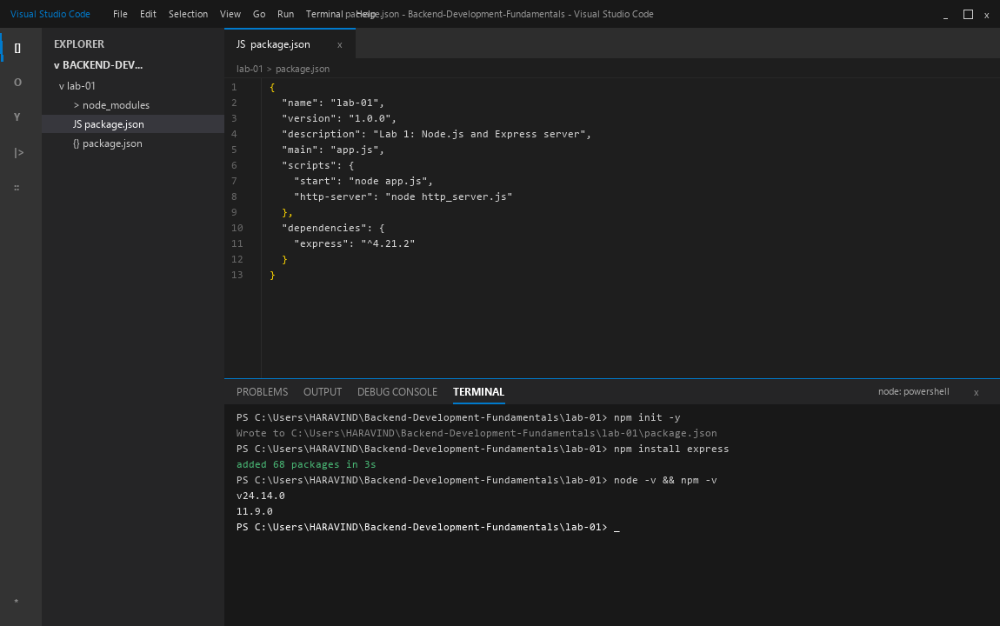
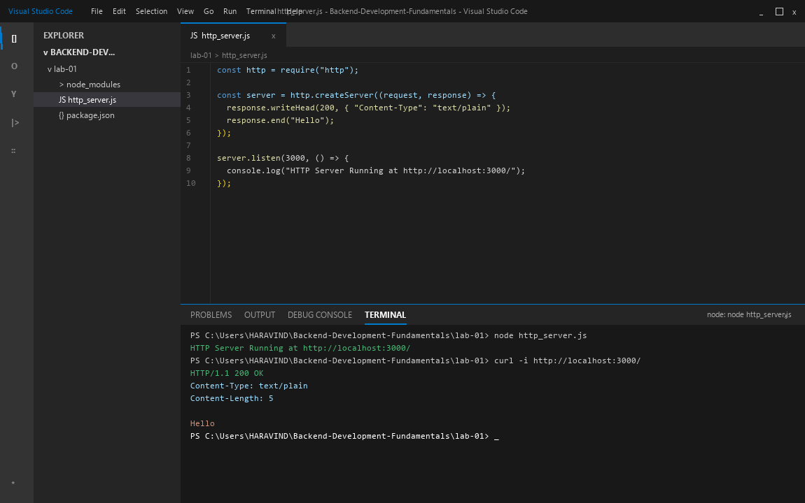
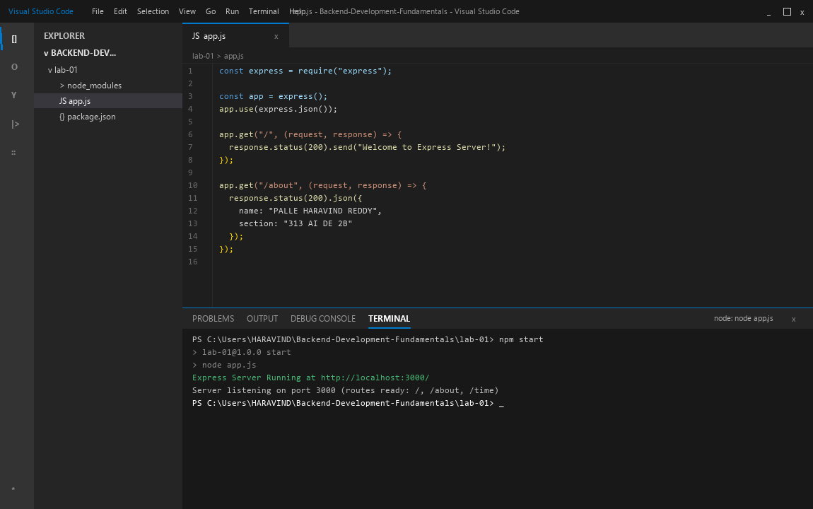
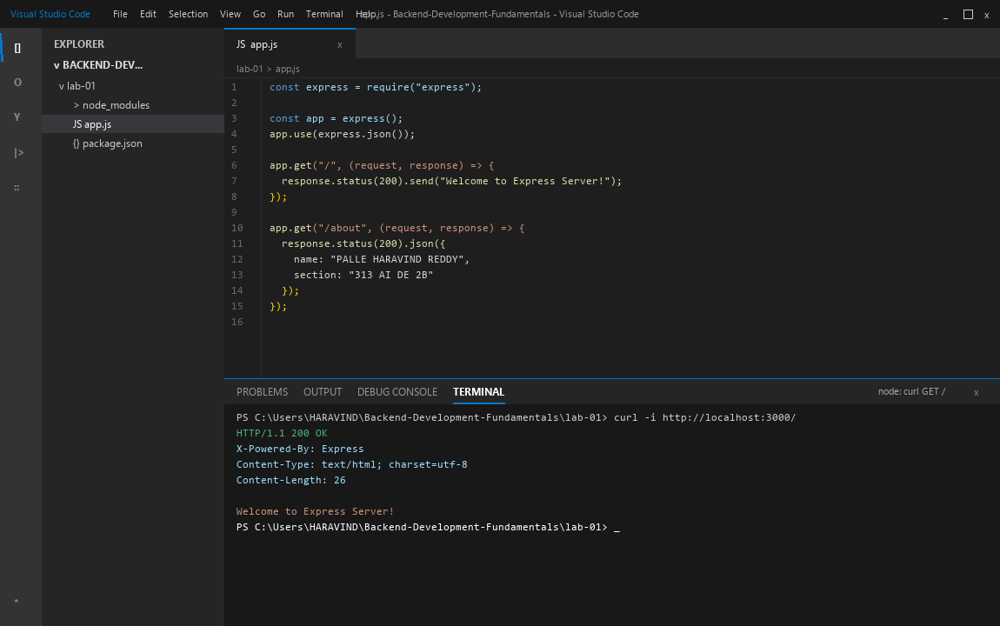
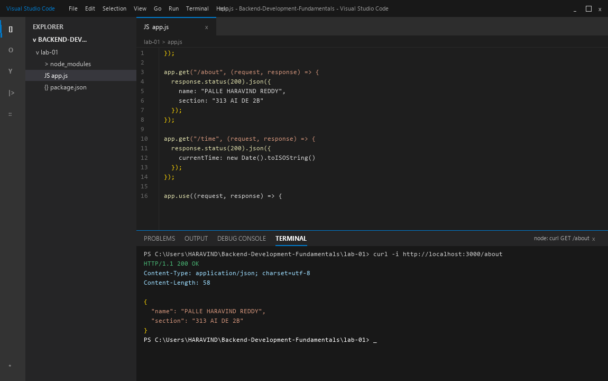
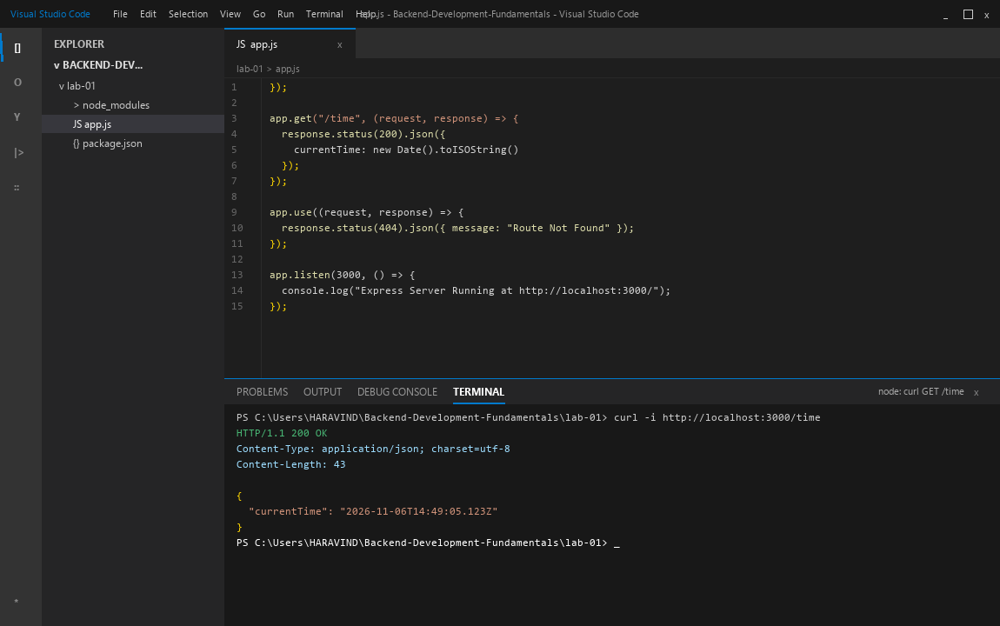
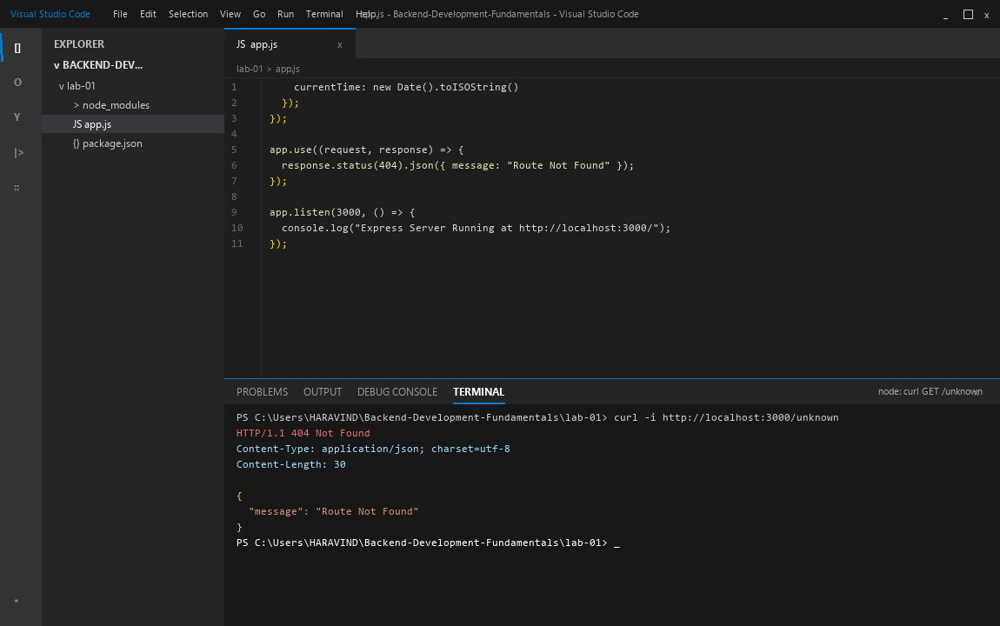

| Information | Details | Additional Information |
| --- | --- | --- |
| Student Name | PALLE HARAVIND REDDY | |
| Student Registration Number | 252U1R5119 | Class & Section: 313 AI DE 2B |
| Study Level : UG/PG/Doctorate | UG | Year & Term: 2 & 2 |
| Subject Name | Backend Development Fundamentals | |
| Teacher / Faculty Name | Mr Yugandhar Gurjalwar | |
| Name of the Assessment | LAB REPORT - 1 | |
| Date of Submission | 6/11/2026 | |

# Lab 1: Node.js and Express server

## Objective
Set up a Node.js project from scratch, explore package management with npm, and build web servers using both the built-in `http` module and the Express.js framework. The lab demonstrates basic routing, serving plain text and structured JSON responses, handling current system time, implementing a 404 fallback handler for undefined paths, and monitoring HTTP status codes.

---

## How to Run

### 1. Prerequisites
- Node.js (version 18 or higher)
- npm (Node Package Manager)

### 2. Navigate to Project Directory
```bash
cd lab-01
```

### 3. Install Dependencies
```bash
npm install express
```

### 4. Running the Native HTTP Server
```bash
node http_server.js
```
The server will start listening on `http://localhost:3000/`.

### 5. Running the Express Application
```bash
node app.js
# or
npm start
```
The Express server will start listening on `http://localhost:3000/`.

---

## Endpoints Table

| Method | Endpoint | Request Body | Response Type | Status Code | Description |
| :--- | :--- | :--- | :--- | :--- | :--- |
| **GET** | `/` | None | Text | `200 OK` | Returns welcome message string. |
| **GET** | `/about` | None | JSON | `200 OK` | Returns student identity details (name and section). |
| **GET** | `/time` | None | JSON | `200 OK` | Returns ISO timestamp of the current system date and time. |
| **ANY** | `*` (Any undefined route) | None | JSON | `404 Not Found` | Catch-all route returning standardized error message. |

---

## Complete Clean Source Code

### `package.json`
```json
{
  "name": "lab-01",
  "version": "1.0.0",
  "description": "Lab 1: Node.js and Express server",
  "main": "app.js",
  "scripts": {
    "start": "node app.js",
    "http-server": "node http_server.js"
  },
  "dependencies": {
    "express": "^4.21.2"
  }
}
```

### `http_server.js`
```javascript
const http = require("http");

const server = http.createServer((request, response) => {
  response.writeHead(200, { "Content-Type": "text/plain" });
  response.end("Hello");
});

server.listen(3000, () => {
  console.log("HTTP Server Running at http://localhost:3000/");
});
```

### `app.js`
```javascript
const express = require("express");

const app = express();
app.use(express.json());

app.get("/", (request, response) => {
  response.status(200).send("Welcome to Express Server!");
});

app.get("/about", (request, response) => {
  response.status(200).json({
    name: "PALLE HARAVIND REDDY",
    section: "313 AI DE 2B"
  });
});

app.get("/time", (request, response) => {
  response.status(200).json({
    currentTime: new Date().toISOString()
  });
});

app.use((request, response) => {
  response.status(404).json({
    message: "Route Not Found"
  });
});

app.listen(3000, () => {
  console.log("Express Server Running at http://localhost:3000/");
});

module.exports = app;
```

---

## Working Output & IDE Screenshots

### 1. Project Initialization & `package.json`
Visual Studio Code IDE view displaying `package.json` configuration and dependency setup.


### 2. Native HTTP Server (`http_server.js`)
VS Code IDE editor and integrated terminal running the built-in `http` server and verifying `curl http://localhost:3000/`.


### 3. Express Application Source Code (`app.js`)
VS Code IDE editor showing the clean Express server code and route architecture without comments.


### 4. Welcome Route (`GET /`)
VS Code integrated terminal output verifying `GET /` returning 200 OK and welcome text.


### 5. About Route (`GET /about`)
VS Code integrated terminal output verifying `GET /about` returning 200 OK and student JSON payload.


### 6. Time Route (`GET /time`)
VS Code integrated terminal output verifying `GET /time` returning 200 OK and current system timestamp.


### 7. Fallback 404 Route (`GET /unknown`)
VS Code integrated terminal output verifying catch-all 404 handler for non-existent paths.


---

## Viva Questions & Answers

### Q1: What is the difference between `package.json` and `node_modules`?
- **`package.json`:** A lightweight manifest file that holds metadata about the project, including project name, version, entry script, custom scripts, and a list of direct dependencies and their semantic version ranges. It is committed to source control.
- **`node_modules`:** A local directory containing the actual downloaded code and binaries of all installed packages, including their transitive dependencies. It is typically large and should never be committed to git (ignored via `.gitignore`).

### Q2: What does `app.listen()` do in an Express application?
- `app.listen(port, [callback])` binds and listens for incoming HTTP connections on the specified port.
- Under the hood, it creates a Node.js `http.Server` instance with Express's request handler and invokes `server.listen()`, transitioning the server into an active listening state to process incoming client requests.

### Q3: What do `request` and `response` objects represent?
- **`request` (or `req`):** An object representing the incoming HTTP request sent by the client. It provides access to request headers, query string parameters (`req.query`), route path parameters (`req.params`), HTTP method (`req.method`), and request body (`req.body`).
- **`response` (or `res`):** An object representing the outgoing HTTP response that the server constructs and sends back to the client. It provides methods to set HTTP status codes (`res.status()`), set response headers (`res.set()`), and send data (`res.send()`, `res.json()`, `res.end()`).

---

## Notes: Problems Faced and Solutions
1. **Port Occupied Error (`EADDRINUSE`):**
   - Attempting to start the Express server on port 3000 while the native HTTP server was still active triggered `EADDRINUSE`.
   - *Solution:* Stopped the previous node process in the terminal before starting the next server instance.
2. **Missing Body Parser Middleware:**
   - Initial test calls attempting to inspect body failed with undefined body.
   - *Solution:* Added `app.use(express.json())` middleware at the top of the Express pipeline to ensure JSON request bodies are correctly parsed into `request.body`.
