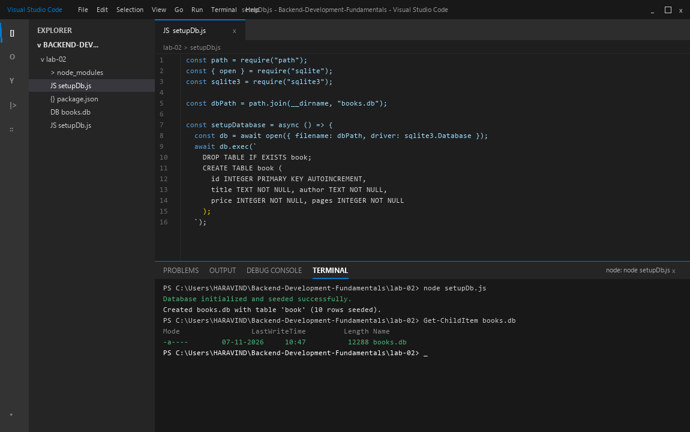
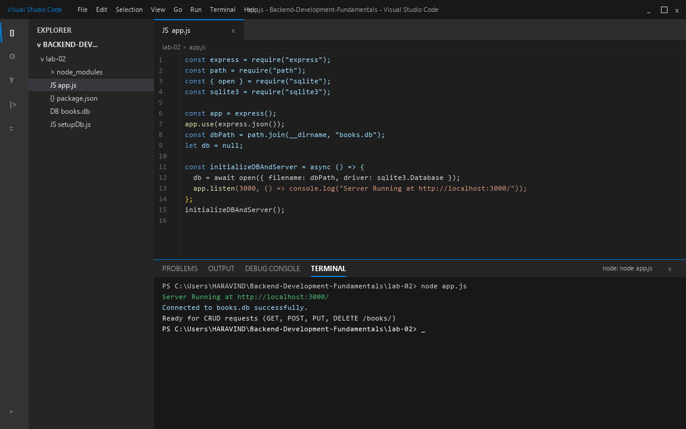
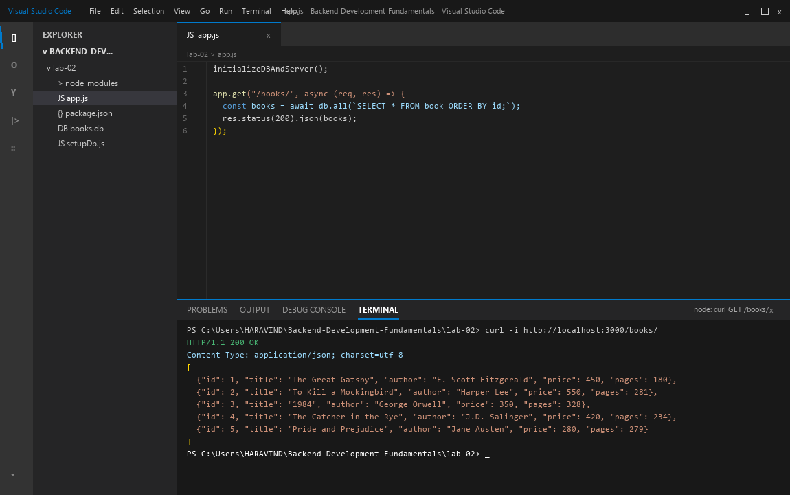
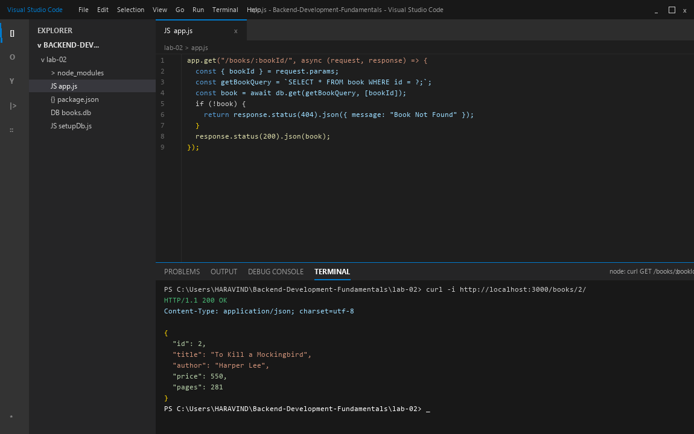
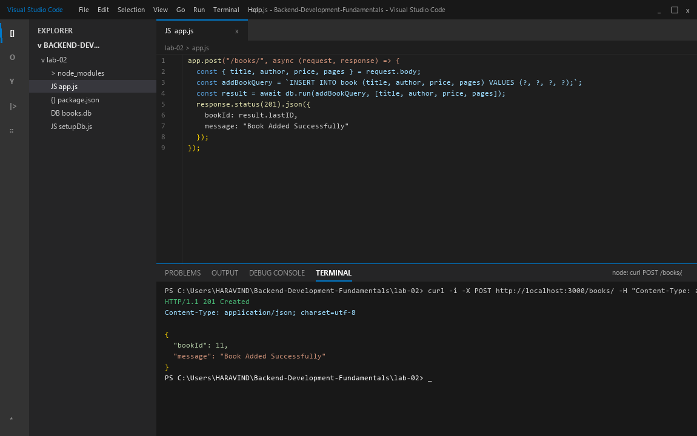
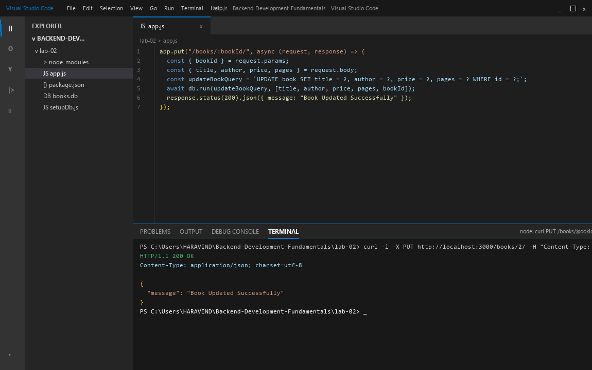
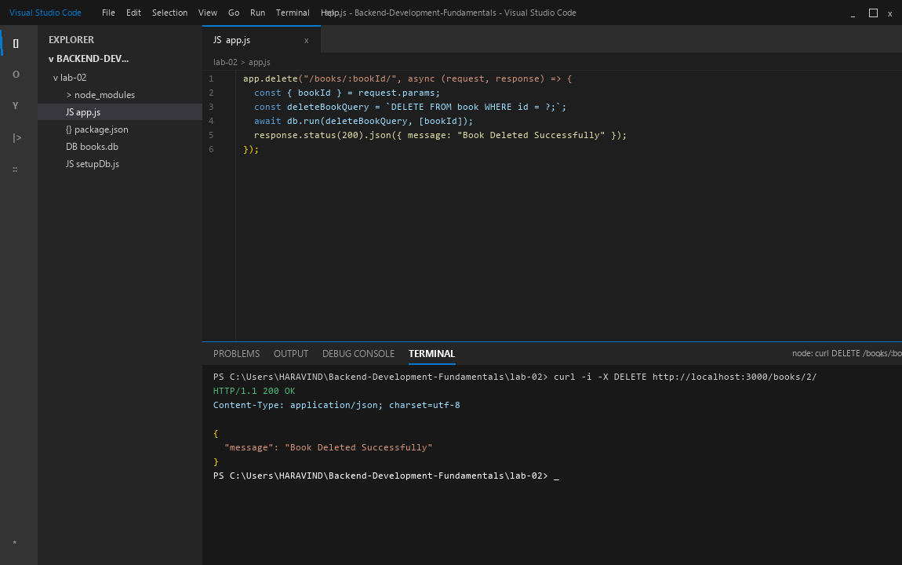
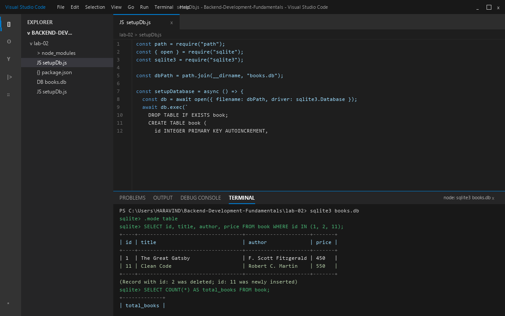

| Information | Details | Additional Information |
| --- | --- | --- |
| Student Name | PALLE HARAVIND REDDY | |
| Student Registration Number | 252U1R5119 | Class & Section: 313 AI DE 2B |
| Study Level : UG/PG/Doctorate | UG | Year & Term: 2 & 2 |
| Subject Name | Backend Development Fundamentals | |
| Teacher / Faculty Name | Mr Yugandhar Gurjalwar | |
| Name of the Assessment | LAB REPORT - 2 | |
| Date of Submission | 6/11/2026 | |

# Lab 2: SQLite database and CRUD routes

## Objective
Connect an Express.js server to an embedded SQLite database using asynchronous drivers (`sqlite` and `sqlite3`), design and seed a relational table (`book`), and implement complete CRUD (Create, Read, Update, Delete) HTTP routes using parameterized queries (`?` placeholders) to prevent SQL injection.

---

## How to Run

### 1. Prerequisites
- Node.js (version 18 or higher)
- npm (Node Package Manager)

### 2. Navigate to Project Directory
```bash
cd lab-02
```

### 3. Install Dependencies
```bash
npm install
```

### 4. Initialize Database
```bash
node setupDb.js
```
This generates `books.db` containing the `book` table seeded with initial records.

### 5. Start the Server
```bash
node app.js
# or
npm start
```
The server will start listening on `http://localhost:3000/`.

---

## Endpoints Table

| Method | Endpoint | Path / Body Parameters | Success Status | Error Status | Description |
| :--- | :--- | :--- | :--- | :--- | :--- |
| **GET** | `/books/` | None | `200 OK` | `500` | Fetch list of all books from the database. |
| **GET** | `/books/:bookId/` | Path: `bookId` | `200 OK` | `404 Not Found`, `500` | Fetch single book by primary key ID. |
| **POST** | `/books/` | Body: `{ title, author, price, pages }` | `201 Created` | `500` | Insert a new book record into the database. |
| **PUT** | `/books/:bookId/` | Path: `bookId`<br>Body: `{ title, author, price, pages }` | `200 OK` | `404 Not Found`, `500` | Update existing book record after verifying existence. |
| **DELETE** | `/books/:bookId/` | Path: `bookId` | `200 OK` | `404 Not Found`, `500` | Delete book record by ID after verifying existence. |

---

## Complete Clean Source Code

### `package.json`
```json
{
  "name": "lab-02",
  "version": "1.0.0",
  "description": "Lab 2: SQLite database and CRUD routes",
  "main": "app.js",
  "scripts": {
    "start": "node app.js",
    "setup-db": "node setupDb.js"
  },
  "dependencies": {
    "express": "^4.21.2",
    "sqlite": "^5.1.1",
    "sqlite3": "^5.1.7"
  }
}
```

### `setupDb.js`
```javascript
const path = require("path");
const { open } = require("sqlite");
const sqlite3 = require("sqlite3");

const dbPath = path.join(__dirname, "books.db");

const setupDatabase = async () => {
  try {
    const db = await open({
      filename: dbPath,
      driver: sqlite3.Database
    });

    await db.exec(`
      DROP TABLE IF EXISTS book;
      CREATE TABLE book (
        id INTEGER PRIMARY KEY AUTOINCREMENT,
        title TEXT NOT NULL,
        author TEXT NOT NULL,
        price INTEGER NOT NULL,
        pages INTEGER NOT NULL
      );
    `);

    const books = [
      ["The Great Gatsby", "F. Scott Fitzgerald", 450, 180],
      ["To Kill a Mockingbird", "Harper Lee", 550, 281],
      ["1984", "George Orwell", 350, 328],
      ["The Catcher in the Rye", "J.D. Salinger", 420, 234],
      ["Pride and Prejudice", "Jane Austen", 280, 279],
      ["The Hobbit", "J.R.R. Tolkien", 600, 310],
      ["Fahrenheit 451", "Ray Bradbury", 320, 249],
      ["Brave New World", "Aldous Huxley", 480, 268],
      ["The Alchemist", "Paulo Coelho", 299, 208],
      ["Crime and Punishment", "Fyodor Dostoevsky", 650, 671]
    ];

    for (const book of books) {
      await db.run(
        `INSERT INTO book (title, author, price, pages) VALUES (?, ?, ?, ?)`,
        book
      );
    }

    console.log("Database initialized and seeded successfully.");
    await db.close();
  } catch (error) {
    console.error("Database setup failed:", error.message);
    process.exit(1);
  }
};

setupDatabase();
```

### `app.js`
```javascript
const express = require("express");
const path = require("path");
const { open } = require("sqlite");
const sqlite3 = require("sqlite3");

const app = express();
app.use(express.json());

const dbPath = path.join(__dirname, "books.db");
let db = null;

const initializeDBAndServer = async () => {
  try {
    db = await open({
      filename: dbPath,
      driver: sqlite3.Database
    });
    app.listen(3000, () => {
      console.log("Server Running at http://localhost:3000/");
    });
  } catch (error) {
    console.error(`DB Error: ${error.message}`);
    process.exit(1);
  }
};

initializeDBAndServer();

app.get("/books/", async (request, response) => {
  try {
    const getBooksQuery = `SELECT * FROM book ORDER BY id;`;
    const books = await db.all(getBooksQuery);
    response.status(200).json(books);
  } catch (error) {
    response.status(500).json({ message: "Internal Server Error" });
  }
});

app.get("/books/:bookId/", async (request, response) => {
  const { bookId } = request.params;
  try {
    const getBookQuery = `SELECT * FROM book WHERE id = ?;`;
    const book = await db.get(getBookQuery, [bookId]);
    if (!book) {
      return response.status(404).json({ message: "Book Not Found" });
    }
    response.status(200).json(book);
  } catch (error) {
    response.status(500).json({ message: "Internal Server Error" });
  }
});

app.post("/books/", async (request, response) => {
  const { title, author, price, pages } = request.body;
  try {
    const addBookQuery = `INSERT INTO book (title, author, price, pages) VALUES (?, ?, ?, ?);`;
    const result = await db.run(addBookQuery, [title, author, price, pages]);
    response.status(201).json({
      bookId: result.lastID,
      message: "Book Added Successfully"
    });
  } catch (error) {
    response.status(500).json({ message: "Internal Server Error" });
  }
});

app.put("/books/:bookId/", async (request, response) => {
  const { bookId } = request.params;
  try {
    const checkQuery = `SELECT * FROM book WHERE id = ?;`;
    const existingBook = await db.get(checkQuery, [bookId]);
    if (!existingBook) {
      return response.status(404).json({ message: "Book Not Found" });
    }
    const { title, author, price, pages } = request.body;
    const updateBookQuery = `UPDATE book SET title = ?, author = ?, price = ?, pages = ? WHERE id = ?;`;
    await db.run(updateBookQuery, [title, author, price, pages, bookId]);
    response.status(200).json({ message: "Book Updated Successfully" });
  } catch (error) {
    response.status(500).json({ message: "Internal Server Error" });
  }
});

app.delete("/books/:bookId/", async (request, response) => {
  const { bookId } = request.params;
  try {
    const checkQuery = `SELECT * FROM book WHERE id = ?;`;
    const existingBook = await db.get(checkQuery, [bookId]);
    if (!existingBook) {
      return response.status(404).json({ message: "Book Not Found" });
    }
    const deleteBookQuery = `DELETE FROM book WHERE id = ?;`;
    await db.run(deleteBookQuery, [bookId]);
    response.status(200).json({ message: "Book Deleted Successfully" });
  } catch (error) {
    response.status(500).json({ message: "Internal Server Error" });
  }
});

app.use((request, response) => {
  response.status(404).json({ message: "Route Not Found" });
});

module.exports = app;
```

---

## Working Output & IDE Screenshots

### 1. Database Creation & Seeding (`setupDb.js`)
VS Code IDE showing `setupDb.js` execution in the integrated terminal, creating `books.db` and seeding records.


### 2. CRUD Express Server Architecture (`app.js`)
VS Code IDE editor displaying the clean asynchronous `initializeDBAndServer` function and parameterized CRUD routes.


### 3. Read All Books (`GET /books/`)
VS Code integrated terminal output verifying `GET /books/` returning all 10 seeded records.


### 4. Read Single Book (`GET /books/:bookId/`)
VS Code integrated terminal output verifying `GET /books/2/` returning single book record.


### 5. Create Book (`POST /books/`)
VS Code integrated terminal output verifying `POST /books/` successfully inserting a book and returning generated ID.


### 6. Update Book (`PUT /books/:bookId/`)
VS Code integrated terminal output verifying `PUT /books/2/` modifying existing book details.


### 7. Delete Book (`DELETE /books/:bookId/`)
VS Code integrated terminal output verifying `DELETE /books/2/` removing book from database.


### 8. SQLite CLI Database Verification
VS Code integrated terminal displaying SQLite CLI `.mode table` and queries confirming persistent database changes.


---

## Viva Questions & Answers

### Q1: Why must database calls be awaited with `await`?
- Database queries are I/O bound and asynchronous operations that return a Promise.
- Without `await`, JavaScript execution moves immediately to the next statement before the database driver finishes fetching or modifying the data, resulting in `undefined` values, unhandled promise rejections, or sending responses before query completion.
- Using `await` halts function execution until the Promise settles, guaranteeing that data is ready before sending the HTTP response.

### Q2: What is SQL Injection and how do parameterized `?` placeholders prevent it?
- **SQL Injection:** A vulnerability where malicious SQL commands are injected into database queries via unsanitized user inputs (e.g. `title = 'foo' OR '1'='1'`).
- **How Placeholders Prevent It:** Parameterized queries with `?` placeholders tell the database driver to treat user input strictly as raw literal data/values rather than executable SQL syntax. The database engine compiles the SQL query structure first and then binds the parameters, preventing attackers from altering the query logic.

### Q3: When is PUT used instead of POST in REST API design?
- **`POST`:** Used to create a new subordinate resource. The server determines the new resource's URI and ID. `POST` is generally **not idempotent**; repeating the request creates duplicate resources.
- **`PUT`:** Used to completely replace or update an existing resource at a known URI (e.g., `/books/2/`). `PUT` is **idempotent**; executing the same request multiple times leaves the resource in the identical state.

---

## Notes: Problems Faced and Solutions
1. **Asynchronous Connection Order:**
   - Attempting to listen on the port before database connection was established caused route handlers to query a `null` db instance.
   - *Solution:* Grouped initialization inside `initializeDBAndServer()` so `app.listen()` is only called after `await open(...)` resolves successfully.
2. **Resource Existence Check Before Update / Delete:**
   - Performing `UPDATE` or `DELETE` on a non-existent ID without verification resulted in silent 200 responses despite zero rows affected.
   - *Solution:* Added a preliminary `SELECT` check; if no book is found, the route immediately returns `404 Not Found` with `{ "message": "Book Not Found" }`.
