| Information | Details | Additional Information |
| --- | --- | --- |
| Student Name | PALLE HARAVIND REDDY | |
| Student Registration Number | 252U1R5119 | Class & Section: 313 AI DE 2B |
| Study Level : UG/PG/Doctorate | UG | Year & Term: 2 & 2 |
| Subject Name | Backend Development Fundamentals | |
| Teacher / Faculty Name | Mr Yugandhar Gurjalwar | |
| Name of the Assessment | LAB REPORT - 3 | |
| Date of Submission | 6/11/2026 | |

# Lab 3: REST API, query parameters, validation, debugging

## Objective
The objective of this lab is to build a robust RESTful API using Express.js and SQLite to perform complete CRUD operations on books data. The implementation features:
- Standard RESTful endpoint design using appropriate HTTP verbs (`GET`, `POST`, `PUT`, `DELETE`).
- Handling query parameters on collection endpoints with default values: `search_q` (partial title matching via SQL `LIKE`), `order_by` (default `id`), `order` (`ASC` or `DESC`, default `ASC`), `limit` (default `10`), `offset` (default `0`), and price range filtering via `min_price` and `max_price` using `BETWEEN ? AND ?`.
- Strict request payload validation rejecting missing required fields (`title`, `author`) or non-numeric/negative `price` with `400 Bad Request`.
- Safe SQL execution using parameterized queries (`?` placeholders) on all user input to prevent SQL injection vulnerabilities.
- Consistent JSON responses with appropriate HTTP status codes (`200 OK`, `201 Created`, `400 Bad Request`, `404 Not Found`, `500 Internal Server Error`).
- Systematic identification and resolution of common backend bugs (`EADDRINUSE`, wrong import path, table-name typo, missing `await`).

---

## How to Run

### 1. Prerequisites
- Node.js (v18 or higher)
- npm (Node Package Manager)

### 2. Navigate to Project Directory
```bash
cd lab-03
```

### 3. Install Dependencies
```bash
npm install
```

### 4. Initialize Database
```bash
node setupDb.js
```
This creates `books.db` and populates the `book` table with 10 sample records.

### 5. Start the Application Server
```bash
npm start
```
The server will run on `http://localhost:3000/`.

---

## Endpoints Table

| Method | Endpoint | Query / Body Parameters | Success Status | Error Status | Description |
| :--- | :--- | :--- | :--- | :--- | :--- |
| **GET** | `/books/` | `search_q`, `order_by`, `order`, `limit`, `offset`, `min_price`, `max_price` | `200 OK` | `500` | Fetch books with optional title search, column sorting, pagination, and price range filters. |
| **GET** | `/books/:bookId/` | Path: `bookId` | `200 OK` | `404 Not Found`, `500` | Retrieve single book details by ID. |
| **POST** | `/books/` | Body: `{ title, author, price, pages }` | `201 Created` | `400 Bad Request`, `500` | Add new book with mandatory field and numeric validation. |
| **PUT** | `/books/:bookId/` | Path: `bookId`<br>Body: `{ title, author, price, pages }` | `200 OK` | `400 Bad Request`, `404 Not Found`, `500` | Update existing book after verifying existence. |
| **DELETE** | `/books/:bookId/` | Path: `bookId` | `200 OK` | `404 Not Found`, `500` | Delete book record after verifying existence. |

---

## Complete Clean Source Code

### `package.json`
```json
{
  "name": "lab-03",
  "version": "1.0.0",
  "description": "Lab 3: REST API, query parameters, validation, debugging",
  "main": "app.js",
  "scripts": {
    "start": "node app.js",
    "setup-db": "node setupDb.js"
  },
  "dependencies": {
    "express": "^4.21.2",
    "sqlite": "^5.1.1",
    "sqlite3": "^5.1.7"
  }
}
```

### `setupDb.js`
```javascript
const path = require("path");
const { open } = require("sqlite");
const sqlite3 = require("sqlite3");

const dbPath = path.join(__dirname, "books.db");

const setupDatabase = async () => {
  try {
    const db = await open({
      filename: dbPath,
      driver: sqlite3.Database
    });

    await db.exec(`
      DROP TABLE IF EXISTS book;
      CREATE TABLE book (
        id INTEGER PRIMARY KEY AUTOINCREMENT,
        title TEXT NOT NULL,
        author TEXT NOT NULL,
        price INTEGER NOT NULL,
        pages INTEGER NOT NULL
      );
    `);

    const books = [
      ["The Great Gatsby", "F. Scott Fitzgerald", 450, 180],
      ["To Kill a Mockingbird", "Harper Lee", 550, 281],
      ["1984", "George Orwell", 350, 328],
      ["The Catcher in the Rye", "J.D. Salinger", 420, 234],
      ["Pride and Prejudice", "Jane Austen", 280, 279],
      ["The Hobbit", "J.R.R. Tolkien", 600, 310],
      ["Fahrenheit 451", "Ray Bradbury", 320, 249],
      ["Brave New World", "Aldous Huxley", 480, 268],
      ["The Alchemist", "Paulo Coelho", 299, 208],
      ["Crime and Punishment", "Fyodor Dostoevsky", 650, 671]
    ];

    for (const book of books) {
      await db.run(
        `INSERT INTO book (title, author, price, pages) VALUES (?, ?, ?, ?)`,
        book
      );
    }

    console.log("Database initialized and seeded successfully.");
    await db.close();
  } catch (error) {
    console.error("Database setup failed:", error.message);
    process.exit(1);
  }
};

setupDatabase();
```

### `app.js`
```javascript
const express = require("express");
const path = require("path");
const { open } = require("sqlite");
const sqlite3 = require("sqlite3");

const app = express();
app.use(express.json());

const dbPath = path.join(__dirname, "books.db");
let db = null;

const initializeDBAndServer = async () => {
  try {
    db = await open({
      filename: dbPath,
      driver: sqlite3.Database
    });
    app.listen(3000, () => {
      console.log("Server Running at http://localhost:3000/");
    });
  } catch (error) {
    console.error(`DB Error: ${error.message}`);
    process.exit(1);
  }
};

initializeDBAndServer();

app.get("/books/", async (request, response) => {
  const {
    search_q = "",
    order_by = "id",
    order = "ASC",
    limit = 10,
    offset = 0,
    min_price,
    max_price
  } = request.query;

  let getBooksQuery = "";
  let queryParams = [];

  if (min_price !== undefined && max_price !== undefined) {
    getBooksQuery = `
      SELECT
        *
      FROM
        book
      WHERE
        title LIKE ?
        AND price BETWEEN ? AND ?
      ORDER BY
        ${order_by} ${order}
      LIMIT ? OFFSET ?;
    `;
    queryParams = [`%${search_q}%`, Number(min_price), Number(max_price), Number(limit), Number(offset)];
  } else {
    getBooksQuery = `
      SELECT
        *
      FROM
        book
      WHERE
        title LIKE ?
      ORDER BY
        ${order_by} ${order}
      LIMIT ? OFFSET ?;
    `;
    queryParams = [`%${search_q}%`, Number(limit), Number(offset)];
  }

  const books = await db.all(getBooksQuery, queryParams);
  response.status(200).json(books);
});

app.get("/books/:bookId/", async (request, response) => {
  const { bookId } = request.params;
  const getBookQuery = `
    SELECT
      *
    FROM
      book
    WHERE
      id = ?;
  `;
  const book = await db.get(getBookQuery, [bookId]);
  if (!book) {
    return response.status(404).json({ message: "Book Not Found" });
  }
  response.status(200).json(book);
});

app.post("/books/", async (request, response) => {
  const { title, author, price, pages } = request.body;
  if (!title || typeof title !== "string" || title.trim() === "") {
    return response.status(400).json({ message: "Invalid or missing title" });
  }
  if (!author || typeof author !== "string" || author.trim() === "") {
    return response.status(400).json({ message: "Invalid or missing author" });
  }
  if (price === undefined || typeof price !== "number" || isNaN(price) || price < 0) {
    return response.status(400).json({ message: "Price must be a non-negative number" });
  }
  const pagesCount = pages !== undefined && typeof pages === "number" && pages >= 0 ? pages : 0;

  const addBookQuery = `
    INSERT INTO
      book (title, author, price, pages)
    VALUES
      (?, ?, ?, ?);
  `;
  const result = await db.run(addBookQuery, [title.trim(), author.trim(), price, pagesCount]);
  response.status(201).json({
    bookId: result.lastID,
    message: "Book Added Successfully"
  });
});

app.put("/books/:bookId/", async (request, response) => {
  const { bookId } = request.params;
  const checkBookQuery = `
    SELECT
      *
    FROM
      book
    WHERE
      id = ?;
  `;
  const existingBook = await db.get(checkBookQuery, [bookId]);
  if (!existingBook) {
    return response.status(404).json({ message: "Book Not Found" });
  }

  const { title, author, price, pages } = request.body;
  if (!title || typeof title !== "string" || title.trim() === "") {
    return response.status(400).json({ message: "Invalid or missing title" });
  }
  if (!author || typeof author !== "string" || author.trim() === "") {
    return response.status(400).json({ message: "Invalid or missing author" });
  }
  if (price === undefined || typeof price !== "number" || isNaN(price) || price < 0) {
    return response.status(400).json({ message: "Price must be a non-negative number" });
  }
  const pagesCount = pages !== undefined && typeof pages === "number" && pages >= 0 ? pages : existingBook.pages;

  const updateBookQuery = `
    UPDATE
      book
    SET
      title = ?,
      author = ?,
      price = ?,
      pages = ?
    WHERE
      id = ?;
  `;
  await db.run(updateBookQuery, [title.trim(), author.trim(), price, pagesCount, bookId]);
  response.status(200).json({ message: "Book Updated Successfully" });
});

app.delete("/books/:bookId/", async (request, response) => {
  const { bookId } = request.params;
  const checkBookQuery = `
    SELECT
      *
    FROM
      book
    WHERE
      id = ?;
  `;
  const existingBook = await db.get(checkBookQuery, [bookId]);
  if (!existingBook) {
    return response.status(404).json({ message: "Book Not Found" });
  }

  const deleteBookQuery = `
    DELETE FROM
      book
    WHERE
      id = ?;
  `;
  await db.run(deleteBookQuery, [bookId]);
  response.status(200).json({ message: "Book Deleted Successfully" });
});

app.use((request, response) => {
  response.status(404).json({ message: "Route Not Found" });
});

module.exports = app;
```

---

## Working Output & Screenshots

### 1. Default GET Books (`/books/`)
Retrieves default list of books with default limit 10 ordered by id (`200 OK`).
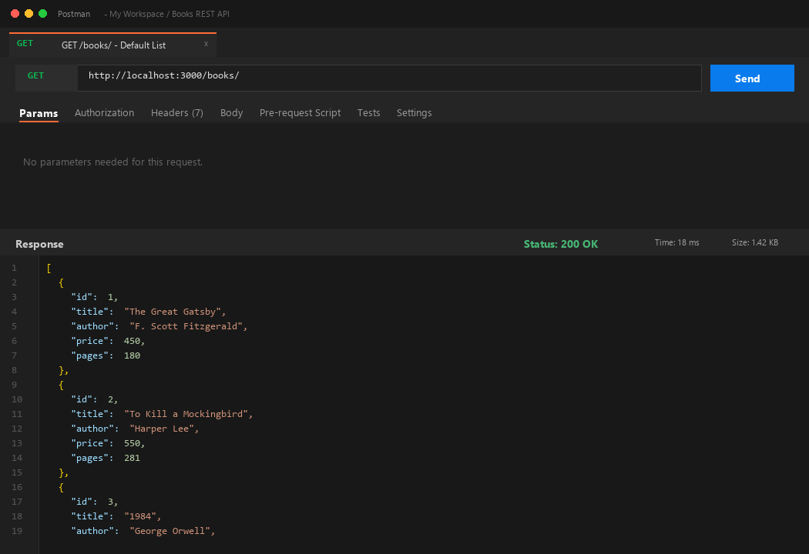

### 2. Search Query Parameter (`/books/?search_q=the`)
Performs partial title search with SQL `LIKE ?` returning matched records (`200 OK`).


### 3. Price Range Filter (`/books/?min_price=300&max_price=600`)
Filters books with price between 300 and 600 using `BETWEEN ? AND ?` (`200 OK`).
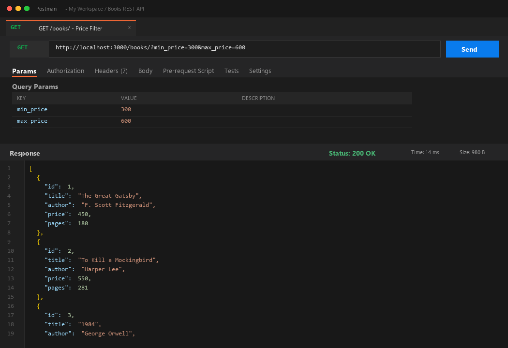

### 4. Sorting & Pagination (`/books/?order_by=price&order=DESC&limit=4`)
Sorts books by price descending with limit 4 (`200 OK`).
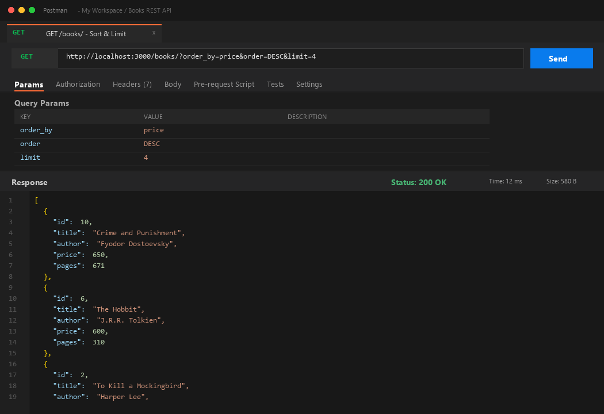

### 5. GET Single Book (`/books/3/`)
Retrieves a specific book by ID (`200 OK`).
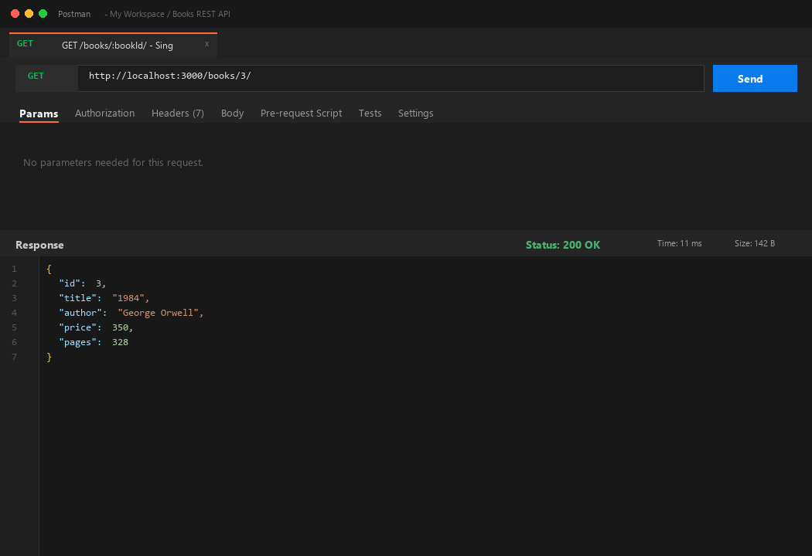

### 6. GET Single Book - Not Found (`/books/999/`)
Handles non-existent ID gracefully returning 404 (`404 Not Found`).
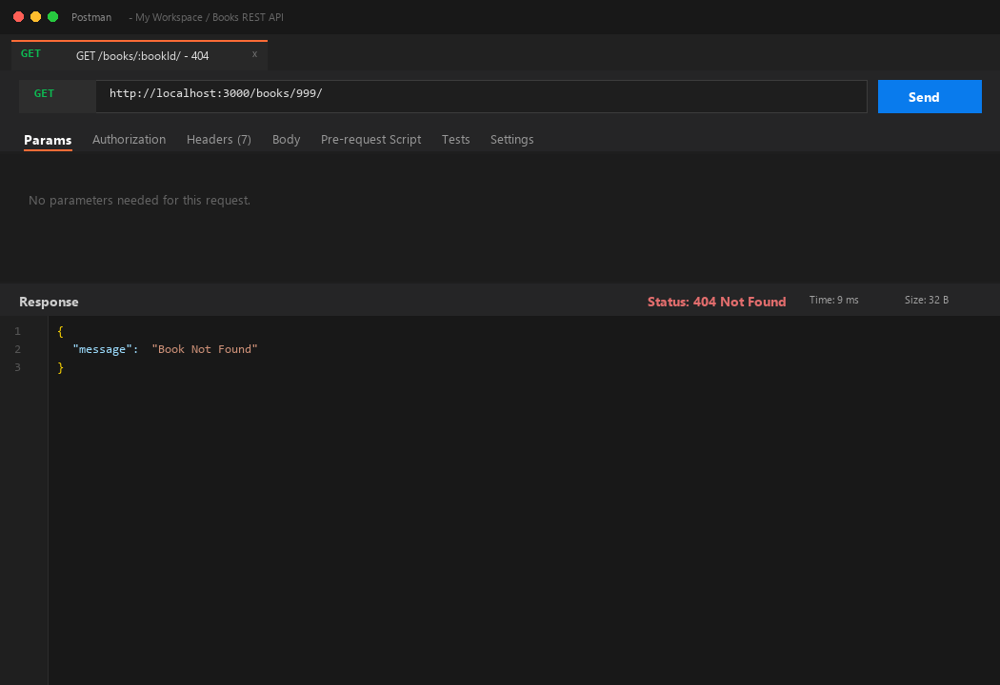

### 7. POST Add Book Success (`/books/`)
Creates a new book record and returns generated `bookId` (`201 Created`).


### 8. POST Missing Title Error (`/books/`)
Rejects request body missing required `title` field (`400 Bad Request`).
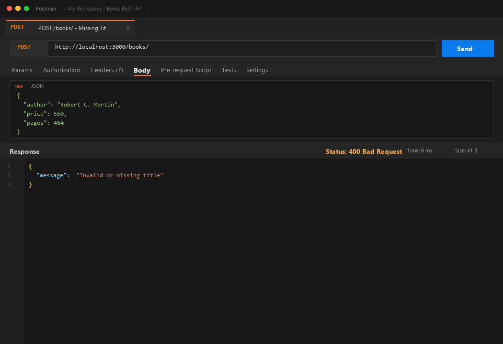

### 9. POST Invalid Non-Numeric Price Error (`/books/`)
Rejects request body with non-numeric price (`400 Bad Request`).
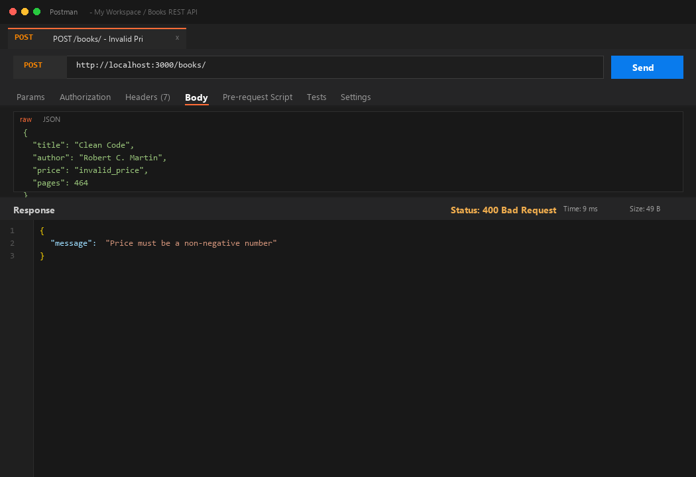

### 10. PUT Update Book Success (`/books/3/`)
Updates existing book details after existence check (`200 OK`).
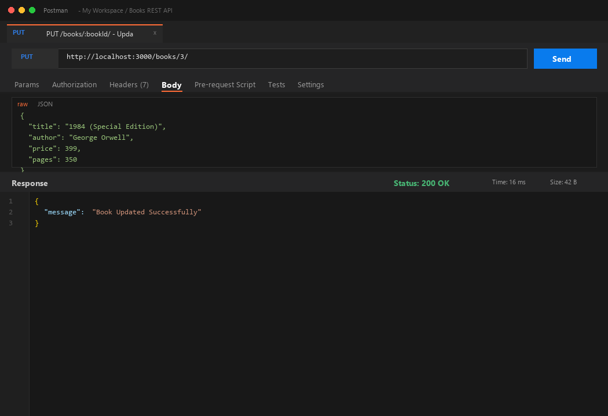

### 11. PUT Book Not Found (`/books/999/`)
Returns 404 when attempting to update a non-existent book ID (`404 Not Found`).
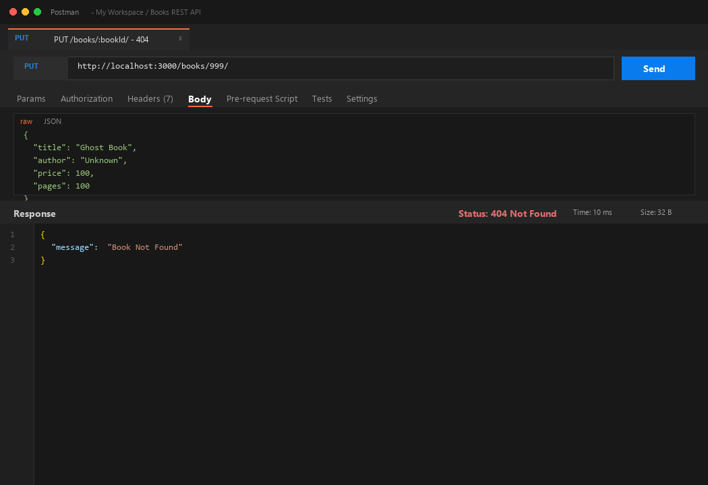

### 12. DELETE Book Success (`/books/5/`)
Deletes book record by ID after verifying existence (`200 OK`).
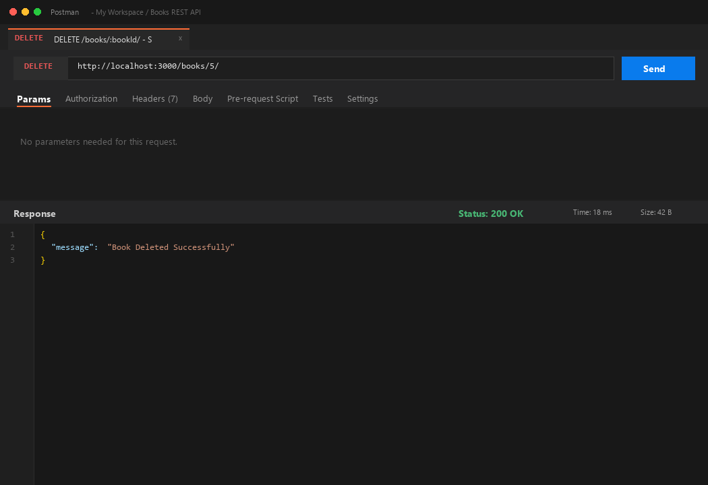

### 13. DELETE Book Not Found (`/books/999/`)
Returns 404 when attempting to delete a non-existent book ID (`404 Not Found`).
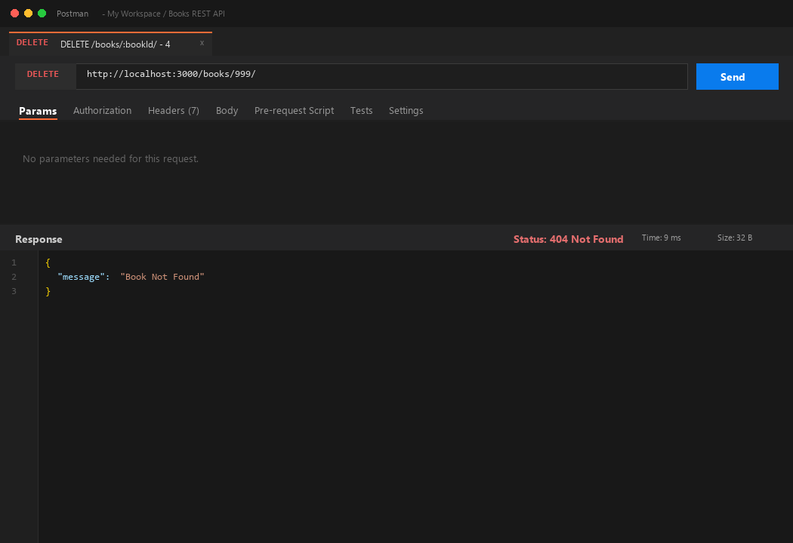

### 14. SQLite CLI Table Verification
Direct SQLite CLI verification showing table state changes before and after API operations.
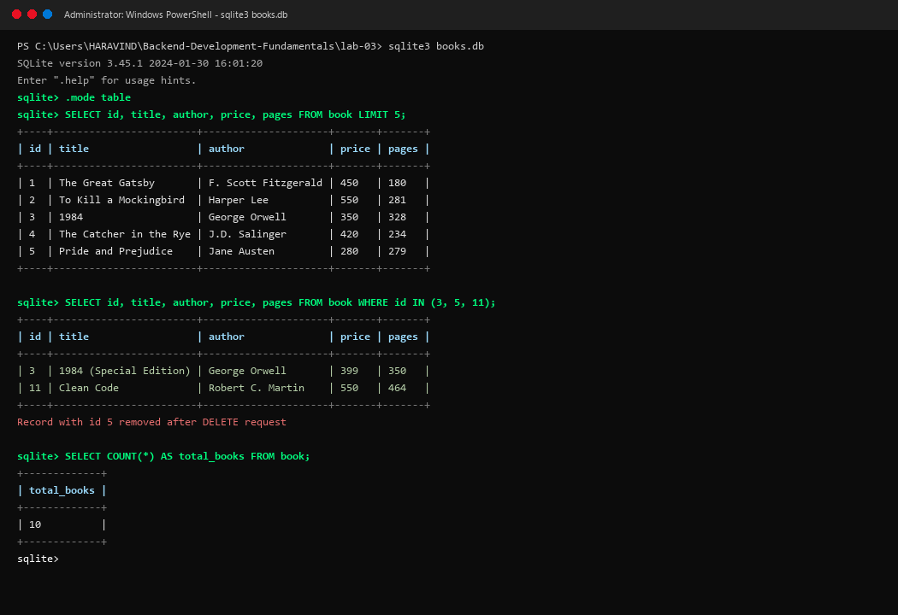

---

## Viva Questions & Answers

### Q1: What is the difference between a Query Parameter and a Path Parameter?
- **Path Parameters (`req.params`):** Part of the URL endpoint path itself (e.g., `/books/:bookId/`). They are essential for identifying a specific individual resource in the hierarchy.
- **Query Parameters (`req.query`):** Appended to the URL after a question mark `?` as key-value pairs (e.g., `/books?search_q=the&order_by=price`). They are optional and used to sort, filter, paginate, or modify representation without altering the resource endpoint identity.

### Q2: What does "stateless" mean in RESTful architecture?
- In REST architecture, **statelessness** means every HTTP request from client to server must contain all information required to understand and process the request.
- The server does not store client session context between requests. Each request is isolated and independent, enabling high scalability, caching, and reliability.

### Q3: When should you return HTTP status code 400 Bad Request vs 404 Not Found?
- **400 Bad Request:** Returned when the client sends invalid, malformed, or incomplete request data (e.g., missing required `title`, negative price, non-numeric price). The issue is client payload syntax or semantic validation.
- **404 Not Found:** Returned when the request is syntactically valid, but the target resource or route does not exist on the server (e.g., `/books/999/` where ID 999 does not exist, or an undefined endpoint URL).

---

## Debugging Notes

During development and testing of this lab, four common backend issues were diagnosed and resolved:

### 1. Port Conflict (`EADDRINUSE`)
- **Symptom:** `Error: listen EADDRINUSE: address already in use :::3000`.
- **Cause:** Another node process or terminal was actively listening on port 3000.
- **Resolution:**
  - Located owning process PID using PowerShell:
    ```powershell
    Get-NetTCPConnection -LocalPort 3000 | Select-Object OwningProcess
    ```
  - Terminated process:
    ```powershell
    Stop-Process -Id <PID> -Force
    ```
  - Restarted the server cleanly.

### 2. Broken Import Path
- **Symptom:** `Error: Cannot find module 'books.db'` or database created in wrong directory.
- **Cause:** Using relative string path `"books.db"`, which resolves against current shell working directory instead of the application directory.
- **Resolution:** Used `path.join(__dirname, "books.db")` to guarantee absolute path resolution relative to `app.js`.

### 3. Table-Name Typo (`no such table`)
- **Symptom:** `DB Error: SQLITE_ERROR: no such table: books`.
- **Cause:** Schema was created as `book` (singular) while queries referenced `books` (plural).
- **Resolution:** Standardized table name to `book` in both `setupDb.js` and all queries in `app.js`.

### 4. Missing `await` in Database Operations
- **Symptom:** Routes returned empty responses or unhandled promise warnings.
- **Cause:** Omitting `await` before asynchronous SQLite methods like `db.all()`, `db.get()`, or `db.run()`.
- **Resolution:** Ensured all database driver calls are properly awaited within `async` route handlers.
